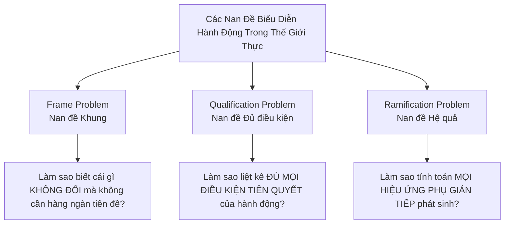

# Chương 4 – Bảng Khái Niệm Bắt Buộc Học Thuộc & Từ Điển Thuật Ngữ (Core Terminology & Memorization Guide)

> **Mục tiêu đạt điểm A+:** Nắm vững toàn bộ thuật ngữ song ngữ Anh – Việt, các định lý giới hạn toán học (Gödel, Turing-Church, Cook-Levin), bản chất triết học và kỹ thuật của các nan đề biểu diễn tri thức (Frame Problem, Non-monotonicity, CWA/OWA) nhằm trả lời chính xác, gãy gọn các câu hỏi lý thuyết phân tích, phản biện và so sánh.

---

## 1. Bảng Đối Chiếu Thuật Ngữ Song Ngữ (Bilingual Terminology Lexicon)

| Thuật ngữ Tiếng Việt | English Term | Ký hiệu / Định nghĩa toán học tóm tắt | Ngữ cảnh ứng dụng & Lưu ý |
|---|---|---|---|
| **Bùng nổ tổ hợp** | Combinatorial Explosion | Độ phức tạp thời gian/không gian tăng cấp lũy thừa $\mathcal{O}(2^n)$ hoặc giai thừa $\mathcal{O}(n!)$ | Giới hạn tính toán của mọi thuật toán tìm kiếm và suy diễn logic khi kích thước tri thức tăng. |
| **Tính khả quyết** | Decidability | Tồn tại thuật toán dừng đúng hạn trên mọi đầu vào: trả về YES nếu $\models \varphi$, NO nếu $\not\models \varphi$ | Logic mệnh đề (PL) là khả quyết (co-NP-complete). Logic bậc nhất tổng quát (FOL) là không khả quyết. |
| **Tính nửa khả quyết** | Semi-decidability | Tồn tại thuật toán dừng và trả lời YES nếu $\models \varphi$; có thể chạy vô hạn (loop) nếu $\not\models \varphi$ | Tính chất của FOL theo Định lý Đầy đủ Gödel (Gödel's Completeness Theorem) và Luận đề Turing-Church. |
| **Tính bất khả quyết** | Undecidability | Không tồn tại bất kỳ thuật toán vạn năng nào luôn dừng và đưa ra câu trả lời đúng cho mọi bài toán | Vấn đề dừng (Halting Problem) của Alan Turing, Bài toán quyết định của David Hilbert (Entscheidungsproblem). |
| **Định lý Bất toàn Gödel** | Gödel's Incompleteness Theorems | Mọi hệ tiên đề hình thức nhất quán đủ mạnh chứa số học Peano đều chứa chân lý toán học không thể chứng minh | Giới hạn tuyệt đối của việc tự động hóa toàn bộ toán học thuần túy bằng chứng minh logic. |
| **Tính đơn điệu** | Monotonicity | Nếu $KB \models \alpha$, thì $KB \cup \{\beta\} \models \alpha$ với mọi công thức mới $\beta$ | Đặc tính cốt lõi của logic cổ điển; khiến hệ thống không thể tự rút lại niềm tin khi có dữ kiện mâu thuẫn mới. |
| **Suy diễn phi đơn điệu** | Non-monotonic Reasoning | Bổ sung tri thức mới $\beta$ có thể làm mất hiệu lực hoặc thu hồi kết luận $\alpha$ đã suy diễn trước đó | Cần thiết để mô hình hóa lý luận con người, tri thức mặc định (default reasoning), luật có ngoại lệ (Tweety). |
| **Giả định Thế giới Đóng** | Closed World Assumption (CWA) | Nếu $KB \not\vdash P(c)$ (không chứng minh được $P(c)$), ta suy ra khẳng định phủ định $\neg P(c)$ | Phổ biến trong Cơ sở dữ liệu quan hệ (SQL) và Logic Programming (Prolog - Negation as Failure). |
| **Giả định Thế giới Mở** | Open World Assumption (OWA) | Nếu $KB \not\vdash P(c)$ và $KB \not\vdash \neg P(c)$, giá trị chân lý của $P(c)$ là "chưa biết" (Unknown) | Nền tảng của Semantic Web, tri thức mở khoa học (OWL/RDF); tránh kết luận vội vàng khi thiếu dữ liệu. |
| **Giả định Định danh Duy nhất** | Unique Name Assumption (UNA) | Mọi hằng số / danh từ riêng khác nhau đều chỉ các thực thể khác nhau trong thế giới: $c_1 \ne c_2$ | Chuẩn mực trong Prolog và DB; trong FOL thuần túy, hai tên gọi khác nhau vẫn có thể quy về cùng một vật thể trừ khi có tiên đề $\neg(A = B)$. |
| **Nan đề Khung** | Frame Problem | Thách thức biểu diễn hiệu quả những gì **không thay đổi** trong thế giới sau khi một hành động diễn ra | Tránh bùng nổ hàng triệu tiên đề khung (Frame Axioms) mô tả trạng thái trơ của thế giới trong Situation Calculus. |
| **Nan đề Đủ điều kiện** | Qualification Problem | Không thể liệt kê hết tất cả các điều kiện tiên quyết cần và đủ trong thực tế để đảm bảo một hành động thành công | Ví dụ: Hành động "Nổ máy xe" yêu cầu có xăng, acquy tốt, ống xả không bị khoai tây nhét, không có bão từ,... |
| **Nan đề Hệ quả** | Ramification Problem | Khó khăn trong việc biểu diễn và tính toán tất cả các hiệu ứng phụ gián tiếp phát sinh từ một hành động | Ví dụ: Di chuyển một chiếc bàn thì các đồ vật đặt trên bàn, bụi bẩn, bóng râm bên dưới bàn cũng bị di chuyển theo. |
| **Nguyên lý Nổ chân lý** | Principle of Explosion (*Ex Falso Quodlibet*) | Từ mâu thuẫn ($KB \models \bot$), có thể suy diễn logic ra mọi mệnh đề tùy ý ($A \land \neg A \models B$) | Lỗi chí mạng của logic cổ điển khi gặp dữ liệu thực tế nhiễu hoặc chứa xung đột nội tại. |
| **Bất định tri thức** | Epistemic Uncertainty | Sự bất định bắt nguồn từ việc thiếu hụt thông tin, tri thức không hoàn hảo của tác tử về thế giới | Giải quyết bằng Lý thuyết Xác suất (Probability Theory), Mạng Bayes (Bayesian Networks). |
| **Tính mơ hồ / Nhập nhằng** | Vague / Fuzzy Concept | Sự bất định bắt nguồn từ việc bản thân khái niệm ngôn ngữ không có ranh giới rõ ràng (ví dụ: "Người cao", "Trời ấm") | Giải quyết bằng Logic mờ (Fuzzy Logic) với hàm thuộc độ liên thuộc $\mu_A(x) \in [0, 1]$. |

---

## 2. Bộ Flashcards Khái Niệm Chuyên Sâu (Deep-Dive Flashcards)

### Flashcard 1: Decidability vs Semi-decidability vs Undecidability
- **Mặt trước:** Phân biệt rõ rệt ba khái niệm *Decidable*, *Semi-decidable*, và *Undecidable* trong bối cảnh Logic hình thức và Tính toán.
- **Mặt sau:**
  - **Decidable (Khả quyết):** Tồn tại một cỗ máy Turing luôn dừng sau số hữu hạn bước trên mọi input và trả về đúng giá trị chân lý (YES/NO). Logic Mệnh đề (Propositional Logic) là khả quyết thông qua Bảng chân trị hoặc Thuật toán DPLL.
  - **Semi-decidable (Nửa khả quyết):** Nếu một câu là hệ quả logic ($\models \varphi$), thuật toán chứng minh (như Phép phân giải Robinson / First-order Resolution) **chắc chắn sẽ dừng và tìm ra chứng minh**. Tuy nhiên, nếu câu đó không phải hệ quả logic ($\not\models \varphi$), thuật toán có thể **chạy lặp vô tận (infinite loop)** và không bao giờ dừng. FOL là nửa khả quyết.
  - **Undecidable (Bất khả quyết):** Không thể tồn tại bất kỳ thuật toán tổng quát nào luôn giải quyết đúng cho mọi bài toán trong lớp đó. Logic Bậc nhất tổng quát xét trên việc xác định tính hợp lệ của mọi câu là bất khả quyết (Turing-Church).

### Flashcard 2: Bản chất của Bùng nổ Tổ hợp (Combinatorial Explosion)
- **Mặt trước:** Tại sao logic hình thức chuẩn xác tuyệt đối nhưng lại bất lực trước các bài toán công nghiệp quy mô lớn?
- **Mặt sau:**
  - Trong logic mệnh đề, kiểm tra tính thỏa được (SAT) là bài toán NP-đầy đủ đầu tiên (Định lý Cook-Levin 1971). Không gian chân trị có kích thước $2^n$ dòng với $n$ biến mệnh đề. Với $n = 100$, $2^{100} \approx 1.26 \times 10^{30}$ trạng thái, vượt xa năng lực tính toán của toàn bộ siêu máy tính trên Trái Đất.
  - Trong FOL, không gian tìm kiếm chứng minh (Proof Space) bùng nổ theo cấp giai thừa hoặc hàm mũ phân nhánh do số lượng vô hạn các số hạng hàm (Function symbols) trong Vũ trụ Herbrand, khiến phép thế đơn nhất Unification tạo ra không gian phân nhánh vô tận.

### Flashcard 3: Nan đề Con chim Tweety và Logic phi đơn điệu (The Tweety Paradox)
- **Mặt trước:** Phân tích nghịch lý kinh điển về con chim Tweety và chứng minh logic cổ điển thất bại như thế nào.
- **Mặt sau:**
  - **Cơ sở tri thức ban đầu:**
    1. $Bird(x) \rightarrow Flies(x)$ (Mọi chim đều biết bay)
    2. $Penguin(x) \rightarrow Bird(x)$ (Mọi chim cánh cụt đều là chim)
    3. $Penguin(Tweety)$ (Tweety là chim cánh cụt)
  - **Suy diễn ban đầu:** Từ (2) và (3) suy ra $Bird(Tweety)$. Từ (1) suy ra $Flies(Tweety)$.
  - **Dữ kiện mới bổ sung:** $Penguin(x) \rightarrow \neg Flies(x)$ (Chim cánh cụt không biết bay).
  - **Hậu quả trong Logic cổ điển:** Ta có đồng thời $Flies(Tweety)$ và $\neg Flies(Tweety)$, dẫn đến mâu thuẫn ($Flies(Tweety) \land \neg Flies(Tweety) \equiv \bot$). Theo *Nguyên lý nổ chân lý (Principle of Explosion)*, từ $\bot$ ta có thể suy ra bất cứ điều vô lý nào như $MoonIsMadeOfCheese$.
  - **Khắc phục:** Sử dụng Logic phi đơn điệu (Default Logic hoặc Circumscription) coi luật bay là mặc định có thể bị ghi đè (overridden) bởi tri thức cụ thể hơn.

### Flashcard 4: Frame Problem và Lời giải Tiên đề Kế thừa (Successor-State Axioms)
- **Mặt trước:** Nan đề Khung (Frame Problem) là gì và Ray Reiter đã giải quyết nó như thế nào?
- **Mặt sau:**
  - **Vấn đề:** Trong giải tích tình huống (Situation Calculus), nếu chỉ biểu diễn các tiên đề hiệu ứng (Effect Axioms) như: nếu Robot sơn cái hộp thì hộp chuyển màu đỏ, ta sẽ không thể biết cái hộp có còn nguyên vị trí cũ hay không, hay các đồ vật khác có bị đổi màu không. Nếu viết các tiên đề khung mô tả cái gì không đổi thì cần xấp xỉ $\mathcal{O}(\mathcal{A} \times \mathcal{F})$ tiên đề (với $\mathcal{A}$ hành động và $\mathcal{F}$ trạng thái), gây bùng nổ biểu diễn.
  - **Giải pháp:** Tiên đề trạng thái kế thừa (Successor-State Axiom - Ray Reiter 1991): Một fluent $F$ đúng ở tình huống $do(a, s)$ khi và chỉ khi hành động $a$ làm cho nó đúng, HOẶC nó đã đúng từ trước và hành động $a$ không làm hỏng nó:
    $$F(x, do(a, s)) \leftrightarrow \left[ ActionCausesF(a, x) \lor (F(x, s) \land \neg ActionCausesNotF(a, x)) \right]$$
    Chỉ cần đúng 1 tiên đề cho mỗi fluent thay vì tích của hành động và fluent.

### Flashcard 5: Phân biệt Sự bất định (Probability) và Tính mơ hồ (Fuzzy Logic)
- **Mặt trước:** Tại sao không thể dùng Xác suất (Probability) để mô hình hóa Logic mờ (Fuzzy Logic) và ngược lại?
- **Mặt sau:**
  - **Xác suất (Epistemic Uncertainty):** Thế giới là nhị phân (Binary - biến cố đã xảy ra hoặc không xảy ra), nhưng chủ thể **thiếu thông tin hoàn hảo**. Ví dụ: Lọ nước được đóng nắp dán nhãn độc với xác suất $P(Poison) = 0.5$. Thực tế bên trong lọ là 100% thuốc độc chết người hoặc 100% nước lọc tinh khiết, nhưng ta chưa mở nắp kiểm tra.
  - **Logic mờ (Degree of Truth / Vagueness):** Sự kiện đã được quan sát hoàn hảo, nhưng **ranh giới khái niệm bản thân nó không rạch ròi**. Ví dụ: Một cốc nước ngọt nhân tạo có độ thuộc khái niệm "nước tinh khiết" là $\mu_{Pure}(x) = 0.5$. Đây không phải là sự kiện ngẫu nhiên, mà là chất lượng của nước nằm ở mức lơ lửng giữa tinh khiết và pha tạp.

---

## 3. Các Bảng So Sánh Đa Chiều Nền Tảng (Multi-dimensional Comparison Tables)

### Bảng 1: Phân cấp Tính Khả quyết & Độ phức tạp tính toán (Decidability Hierarchy)

| Hệ Logic / Bài toán | Tính khả quyết | Độ phức tạp lý thuyết | Thuật toán giải điển hình | Khả năng dừng thực tế |
|---|---|---|---|---|
| **Logic Mệnh đề (Propositional Logic - PL)** | Khả quyết (Decidable) | NP-complete (SAT), co-NP-complete (Entailment) | DPLL, CDCL, Truth Table, WalkSAT | Luôn dừng; giải được hàng triệu biến trong SAT solvers hiện đại. |
| **Logic Vị từ Đơn tử (Monadic FOL - chỉ chứa vị từ 1 ngôi)** | Khả quyết (Decidable) | NExpTime-complete | Phân giải rút gọn, Phương pháp ngữ nghĩa | Luôn dừng nhưng chi phí thời gian cực lớn nếu công thức phức tạp. |
| **Logic Vị từ Đoạn Horn (Horn Logic)** | Khả quyết / Nửa khả quyết tùy hệ | Đa thức $\mathcal{O}(N)$ cho PL; Nửa khả quyết cho FOL | SLD-Resolution (Prolog), Forward Chaining | Nhanh, thực dụng trong hệ chuyên gia và cơ sở dữ liệu tri thức. |
| **Logic Bậc nhất Tổng quát (General FOL)** | Nửa khả quyết (Semi-decidable) | Không thuộc bất kỳ lớp Turing nào (Không khả quyết) | Phân giải Robinson (Resolution), Tableau | Dừng nếu câu là chân lý; có thể lặp vô tận (diverge) nếu câu sai. |
| **Logic Bậc hai trở lên (SOL / HOL)** | Bất khả quyết hoàn toàn (Undecidable) | Thậm chí không nửa khả quyết (Incomplete) | Xấp xỉ, Hóa giải tương tác người - máy (Interactive Theorem Provers) | Không có thủ tục chứng minh vạn năng đầy đủ. |

---

### Bảng 2: So Sánh Giả Định Thế Giới (Closed World vs Open World Assumption)

| Tiêu chí so sánh | Giả định Thế giới Đóng (CWA) | Giả định Thế giới Mở (OWA) |
|---|---|---|
| **Bản chất triết lý** | Tri thức hiện có là toàn vẹn, hoàn hảo và đầy đủ. | Tri thức luôn là chưa hoàn chỉnh; cái chưa biết không có nghĩa là không tồn tại. |
| **Xử lý khi $KB \not\vdash \varphi$** | Suy ra khẳng định phủ định: $\neg \varphi$ là TRUE. | Coi giá trị chân lý của $\varphi$ là UNKNOWN (Chưa xác định). |
| **Hệ thống áp dụng điển hình** | SQL / RDBMS, Hệ lập trình Logic Prolog, Lập lịch tự động. | Mạng ngữ nghĩa Semantic Web (OWL, RDF), Tri thức y khoa, Khoa học mở. |
| **Ưu điểm lớn nhất** | Cho phép suy diễn dứt khoát, gọn gàng mà không cần lưu trữ hàng triệu tiên đề phủ định. | Tránh kết luận sai lầm mang tính suy diễn vội vã trong môi trường phân tán và động. |
| **Nhược điểm / Nguy cơ** | Cực kỳ nguy hiểm khi cơ sở tri thức bị khuyết thiếu dữ liệu thực tế. | Rất khó đưa ra các kết luận dứt khoát nếu không có thông tin phủ định rõ ràng. |
| **Ví dụ minh họa** | Danh sách chuyến bay: Không có chuyến Hà Nội - Paris lúc 14h $\Rightarrow$ Khẳng định không có chuyến bay đó. | Danh sách nghiên cứu gen: Chưa ghi nhận gen gây ung thư X $\Rightarrow$ Không được kết luận gen đó vô hại. |

---

### Bảng 3: Bộ Ba Nan Đề Hành Động (The Triad of Action Problems)

| Tiêu chí | Frame Problem (Nan đề Khung) | Qualification Problem (Đủ điều kiện) | Ramification Problem (Hệ quả gián tiếp) |
|---|---|---|---|
| **Trọng tâm nan đề** | Trạng thái bảo toàn (Inertia of the world). | Điều kiện tiên quyết (Preconditions). | Hiệu ứng phái sinh (Side-effects / Indirect effects). |
| **Câu hỏi bản chất** | Làm sao để hệ thống biết sau khi thực hiện hành động $A$, những trạng thái không liên quan vẫn được giữ nguyên? | Làm sao để đảm bảo hành động $A$ chắc chắn thành công khi không thể liệt kê hết mọi yếu tố cản trở trong thế giới? | Làm sao để hệ quả kéo theo của việc thay đổi trạng thái được cập nhật mà không cần định nghĩa thủ công từng trường hợp? |
| **Giải pháp kinh điển** | Tiên đề trạng thái kế thừa của Reiter (Successor-State Axioms). | Lý thuyết mặc định (Default assumptions), Logic phi đơn điệu, Mạng xác suất Bayes. | Ràng buộc trạng thái (State constraints) và Tiên đề quy luật nhân quả (Causal rules). |

---

## 4. Bẫy Thi Cử & Những Sai Lầm Chết Người (Deadly Exam Traps)

1. **Bẫy 1: Đồng nhất Undecidable (Bất khả quyết) với "Không giải được trường hợp nào".**
   - *Sai lầm:* Thí sinh nghĩ rằng bài toán bất khả quyết thì máy tính hoàn toàn bó tay.
   - *Sự thật chuẩn A+:* Bất khả quyết chỉ khẳng định **không tồn tại một thuật toán vạn năng luôn đúng cho mọi input bất kỳ**. Đối với từng lớp bài toán con cụ thể hoặc hàng tỷ trường hợp thực tế, thuật toán vẫn có thể giải quyết nhanh chóng trong vài mili-giây.
2. **Bẫy 2: Hiểu nhầm OWA (Thế giới Mở) đồng nghĩa với "Mọi điều chưa biết đều là True".**
   - *Sai lầm:* Nghĩ rằng nếu không biết thì ta có quyền coi nó là đúng.
   - *Sự thật chuẩn A+:* Trong OWA, nếu $KB \not\vdash \alpha$ và $KB \not\vdash \neg\alpha$, câu $\alpha$ có giá trị là **Unknown (Chưa xác định)**. Hệ thống mở chấp nhận cả mô hình thế giới nơi $\alpha$ đúng và mô hình thế giới nơi $\alpha$ sai.
3. **Bẫy 3: Coi Logic mờ (Fuzzy Logic) là một dạng "Ước lượng Xác suất thô sơ".**
   - *Sai lầm:* Nói độ thuộc $\mu(x) = 0.8$ có nghĩa là $80\%$ khả năng $x$ xảy ra.
   - *Sự thật chuẩn A+:* Hoàn toàn sai bản chất khoa học! Độ thuộc trong Logic mờ là **mức độ tương thích của một thực thể với một khái niệm không có ranh giới sắc nhọn**, không liên quan đến biến cố ngẫu nhiên hay tần suất lặp lại của sự kiện.
4. **Bẫy 4: Quên điều kiện của Định lý Bất toàn Gödel.**
   - *Sai lầm:* Phát biểu ngắn gọn "Mọi hệ thống logic đều chứa chân lý không chứng minh được".
   - *Sự thật chuẩn A+:* Định lý Gödel chỉ áp dụng cho các hệ tiên đề **hình thức, nhất quán (consistent) và đủ mạnh để biểu diễn số học Peano (chứa phép cộng và phép nhân trên số tự nhiên)**. Các hệ logic đơn giản như Mệnh đề (PL) hoặc Vị từ Đơn tử (Monadic FOL) hoàn toàn đầy đủ và khả quyết!

---

## 5. Động Từ Chỉ Lệnh Phòng Thi & Chiến Thuật Trả Lời (Action Verbs Guide)

| Động từ đề thi | Yêu cầu hành động chuẩn A+ | Cấu trúc câu trả lời tối ưu |
|---|---|---|
| **Explain the limitation...** | Trình bày nguyên nhân gốc rễ, bản chất toán học/kỹ thuật và hệ quả thực tiễn của hạn chế. | 1. Định nghĩa hạn chế $\rightarrow$ 2. Cơ chế gây ra (Toán học / Tính toán) $\rightarrow$ 3. Ví dụ minh họa thực tế $\rightarrow$ 4. Hướng tiếp cận khắc phục trong AI hiện đại. |
| **Distinguish / Compare...** | Lập bảng đối sánh đa chiều hoặc phân tích từng cặp tiêu chí đối lập rõ ràng. | Dẫn dắt 1 câu $\rightarrow$ Bảng phân biệt (Bản chất, Giả định, Toán học, Hệ thống đại diện) $\rightarrow$ Đưa ra kết luận điều kiện chọn lựa khi triển khai. |
| **Illustrate with an example...** | Dùng các ví dụ chuẩn mực trong giáo trình (Con chim Tweety, Nổ máy xe hơi, Khối Rubik, Cốc nước). | Nêu bài toán $\rightarrow$ Thể hiện bằng ký hiệu logic chính thống $\rightarrow$ Chỉ ra bước logic cổ điển bị gãy/bế tắc $\rightarrow$ Cách giải quyết đúng. |
| **Formulate / Formalize...** | Viết biểu thức toán học hoặc logic vị từ chuẩn xác, đầy đủ lượng từ $\forall, \exists$ và các biến tình huống $s$. | Khai báo miền đối tượng và các vị từ $\rightarrow$ Viết công thức chính xác $\rightarrow$ Chú thích ý nghĩa từng thành phần. |

---

## 6. Bảng Kiểm Năng Lực Trước Giờ Thi (Pre-Exam Competency Checklist)

- [ ] Tôi định nghĩa chính xác và phân biệt được 3 khái niệm: **Decidable**, **Semi-decidable**, và **Undecidable** theo lý thuyết máy Turing.
- [ ] Tôi giải thích được **Bùng nổ tổ hợp (Combinatorial explosion)** bằng cả độ phức tạp thuật toán và ví dụ không gian trạng thái thực tế.
- [ ] Tôi trình bày được nghịch lý con chim **Tweety** chứng minh sự thất bại của **Tính đơn điệu (Monotonicity)** và cơ chế của **Nguyên lý nổ chân lý (Ex Falso Quodlibet)**.
- [ ] Tôi phân biệt rạch ròi bản chất giữa **Giả định Thế giới Đóng (CWA)** và **Giả định Thế giới Mở (OWA)** cùng ngữ cảnh ứng dụng của từng loại.
- [ ] Tôi phân tích được bản chất của bộ ba nan đề hành động: **Frame Problem**, **Qualification Problem**, và **Ramification Problem**.
- [ ] Tôi viết đúng dạng tổng quát của **Tiên đề trạng thái kế thừa (Successor-State Axioms)** của Reiter để giải quyết Frame Problem.
- [ ] Tôi phân biệt được một cách khoa học giữa **Bất định tri thức (Epistemic Uncertainty - Xác suất)** và **Tính mơ hồ khái niệm (Vagueness - Logic mờ)** mà không bị nhầm lẫn.
